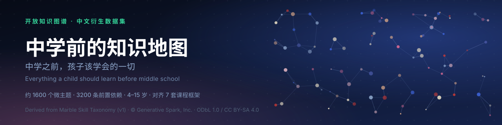
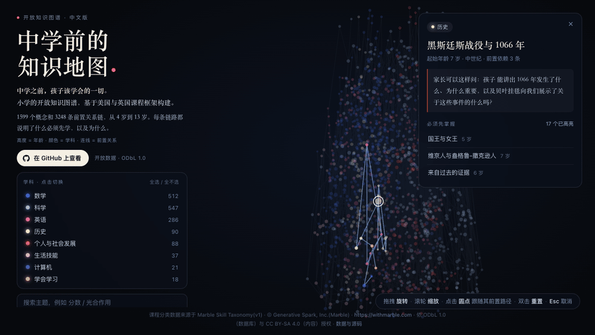

<h1 align="center">中学前的知识地图</h1>

<h3 align="center">中学之前，孩子该学会的一切<br>中文本地化的儿童学习开放知识图谱 · 1600 个微主题 · 3200 条前置依赖</h3>

<p align="center">
<a href="https://github.com/marspang/kids-learning-graph-zh/releases"></a>
<a href="https://github.com/withmarbleapp/os-taxonomy"></a>


<a href="https://marspang.github.io/kids-learning-graph-zh/"></a>
</p>

[Marble Skill Taxonomy (v1)](https://github.com/withmarbleapp/os-taxonomy) 的**中文本地化衍生数据集** —— 一张描述「孩子在小学阶段到底要学会什么」的开放知识图谱。<br>
不只是一份翻译：把 1600 个微主题、3200 条前置依赖、176 篇领域摘要全部中文化，并附一张开箱即用的 **3D 交互地图**。

- 约 **1600 个微主题**（micro-topic），每条含中文名称、说明、掌握证据、家长向评估问句；
- 约 **3200 条前置依赖**（「要学 X 先得会 Y」），每条带中文理由与 hard/soft 强度；
- **领域摘要**（clusters）**176 篇**，按学科 × 领域 × 起始年龄组织；
- 对齐 **7 套课程框架**（美国 CCSS / NGSS、英国国家课程等），仅保留**标准代码与链接**；
- 适用年龄：**4–15 岁**，主战场为 **5–12 岁**（小学段）。

> 本项目是 [withmarbleapp/os-taxonomy](https://github.com/withmarbleapp/os-taxonomy) 的衍生翻译作品，
> 与 Marble 官方**无隶属或背书关系**。必须保留的署名见 [ATTRIBUTION.md](./ATTRIBUTION.md)。

## 目录

- [它长什么样](#它长什么样)
- [快速开始](#快速开始) · [常用参数](#常用参数)
- [数据契约](#数据契约)
- [目录结构](#目录结构)
- [上游内容规模（来自 Marble Skill Taxonomy v1）](#上游内容规模来自-marble-skill-taxonomy-v1)
- [常见问题 FAQ](#常见问题-faq)
- [致谢与许可](#致谢与许可)

---

## 它长什么样



每个点是一个微主题，颜色代表学科；高度是年龄；每条线都是一条前置关系。点中任意概念，就能沿着它的前置路径一路回溯（[完整画质视频](media/curriculum-viz.mp4)）。

打开 **[在线知识地图](https://marspang.github.io/kids-learning-graph-zh/)**（或本地直接打开 `docs/index.html`）就能自己转起来：

- **高度 = 年龄**：竖轴严格按起始年龄从 4 岁排到 13 岁，越往上越难；
- **水平位置 = 依赖关系**：靠力导向布局展开，前置关系越紧密的主题聚得越近；
- **颜色 = 学科**：数学 / 科学 / 英语 / 历史 / 个人与社会发展 / 生活技能 / 计算机 / 学会学习 八色区分；
- **交互**：拖拽**旋转**、滚轮**缩放**、点击**圆点**后沿着它的**前置路径**一路回溯 —— 一眼看清「学会这一条之前，必须先会哪些」。

演示页是**单文件、零依赖**的纯静态页面（自研 canvas 渲染，不加载任何第三方库），丢进任何静态托管即可运行。
数据契约与官方一致，因此任何针对上游写的可视化代码都能**直接复用**，只是文案换成了中文。

> 上面这张动图由 `npm run gif` 自动录制：Playwright 打开页面的 `?rec=1` 录制模式逐帧截图，ffmpeg 合成 GIF 与 MP4，产物在 `media/`。

<p align="center">
  <b>约 1600 个微主题 · 3200 条前置依赖 · 8 个学科 · 4–15 岁</b>
</p>

---

## 快速开始

先整仓库克隆（脚本之间会互相调用，不建议单文件下载）：

```bash
git clone https://github.com/marspang/kids-learning-graph-zh.git
cd kids-learning-graph-zh
npm install
```

然后按顺序跑这四步：

```bash
# 1) 拉取上游数据（自动校验 sha256 并锁定版本）
npm run fetch

# 2) 翻译（任意 OpenAI 兼容接口：DeepSeek / 火山方舟 / OpenAI / Moonshot / Qwen 等）
export LLM_API_KEY=sk-xxxx
export LLM_BASE_URL=https://api.deepseek.com/v1   # 火山方舟示例：https://ark.cn-beijing.volces.com/api/v3
export LLM_MODEL=deepseek-chat
npm run translate                 # 全量；核心三件套
npm run pilot                     # 只翻 120 条，先看效果

# 3) 生成 3D 图谱数据包（力导向布局 + 打包）
npm run build
npm run demo                      # 可选：把最新数据重新注入演示页 docs/index.html
npm run gif                       # 可选：重录 README 动图（需 Playwright + ffmpeg）

# 4) 校验（完整性 / 覆盖率 / 占位符）
npm run validate
```

> 上一节那个 [在线知识地图](https://marspang.github.io/kids-learning-graph-zh/) 就是这么产出的：
> `npm run build` 算出 x/z 坐标 → `npm run demo` 把 `graphdata.json` 内联进 `docs/index.html`。

### 常用参数

| 变量 / 参数 | 说明 | 默认 |
| --- | --- | --- |
| `LLM_API_KEY` | 兼容接口的 API Key（也可用 `DEEPSEEK_API_KEY`） | — |
| `LLM_BASE_URL` | OpenAI 兼容接口地址 | `https://api.deepseek.com/v1` |
| `LLM_MODEL` | 模型名 | `deepseek-chat` |
| `BATCH_SIZE` | 每批片段数 | 24 |
| `CONCURRENCY` | 并发请求数 | 4 |
| `--limit=N` | 只处理前 N 个未译片段（试跑用） | 不限 |
| `--include-research` | 同时翻译 `teaching-research.json`（约 2100 万字符，费用高） | 关闭 |
| `--retranslate` | 忽略缓存，全部重翻 | 关闭 |
| `LAYOUT_SEED` | 布局随机种子（可复现） | 20260720 |
| `LAYOUT_TICKS` | 力导向迭代步数 | 420 |
| `PLAYWRIGHT_PATH` | `npm run gif` 用的 Playwright 模块路径（没装在项目里时指定） | `playwright` |
| `CHROME_PATH` | `npm run gif` 用的浏览器可执行文件（想复用已装的 Chrome 时指定） | Playwright 自带 |

> 翻译进度写入 `data/zh/.cache.jsonl`（已 gitignore），**中断后重跑会自动续传**，不用从零再来。

---

## 数据契约

- 结构、`id`、依赖关系、标准代码**完全沿用上游**，中文版只在文本字段上做替换，因此任何针对上游写的代码都能**直接复用**。
- 学科字段额外提供 `subjectZh`（确定性映射，不经过模型），`subject` 保持英文以兼容按学科分组。
- `name` 里若出现 `{{name}}` 占位符（官方原文如此），表示此处应填入学习者姓名，中文版**原样保留**。

`data/dist/graphdata.json` 的结构：

| 字段 | 含义 |
| --- | --- |
| `groups` / `gcol` | 8 个学科的中文名与配色 |
| `H` / `ageMin` / `ageMax` | 年龄轴总高度、最小学龄、最大学龄 |
| `nodes[{ i, x, y, z, g, a, c, col, dm, t, q }]` | `i`=id、`x/y/z`=坐标、`g`=学科下标、`a`=起始年龄、`c`=中心度、`col`=配色、`dm`=领域、`t`=中文名、`q`=评估问句 |
| `links[[前置下标, 主题下标]]` | 前置依赖边（`source` 必须先于 `target`） |

**`y` 轴即年龄**（模拟结束后精确归位，保证「高度=年龄」严格成立），`x` / `z` 由依赖关系力导向布局决定。

---

## 目录结构

```text
kids-learning-graph-zh/
├── assets/banner/               README 首图（自包含 SVG）
├── media/                       README 动图与视频（由 npm run gif 生成）
├── docs/index.html              3D 交互演示页（单文件、零依赖，可直接给 Pages）
├── data/
│   ├── source/                  上游原始 JSON（含 UPSTREAM.json 版本锁定信息）
│   ├── zh/                      中文数据集（本仓库的核心产出）
│   │   ├── topics.zh.json
│   │   ├── dependencies.zh.json
│   │   ├── clusters.zh.json
│   │   ├── teaching-research.zh.json   # 需 --include-research 才生成
│   │   └── meta.json            生成信息 + 上游版本
│   └── dist/graphdata.json      含 3D 坐标，供前端直接渲染
├── scripts/
│   ├── fetch.mjs                下载上游数据并按 sha256 校验
│   ├── translate.mjs            分批翻译（可断点续跑）
│   ├── glossary.tsv             术语表（保证全库译法一致）
│   ├── build-graph.mjs          力导向算 3D 坐标 + 打包
│   ├── build-demo.mjs           把 graphdata.json 注入演示页
│   ├── build-gif.mjs            录制 README 动图（Playwright + ffmpeg）
│   └── validate.mjs             完整性 / 覆盖率校验
├── LICENSE                      ODbL 1.0（数据层）
├── LICENSE-CONTENT              CC BY-SA 4.0（文本层）
└── ATTRIBUTION.md               署名与上游课标声明（必读）
```

---

## 上游内容规模（来自 Marble Skill Taxonomy v1）

本仓库**不改结构、不改关系**，只做文本本地化与可视化。中文数据集的规模：

| 学科 | 微主题 | 起始年龄跨度 |
| --- | --- | --- |
| 科学 | 547 | 4–13 |
| 数学 | 512 | 4–13 |
| 英语 | 286 | 5–13 |
| 历史 | 90 | 6–13 |
| 个人与社会发展 | 88 | 4–13 |
| 生活技能 | 37 | 4–13 |
| 计算机 | 21 | 5–13 |
| 学会学习 | 18 | 5–13 |
| **合计** | **1599** | **4–13** |

外加 **3248 条前置依赖**与 **176 篇领域摘要**（覆盖率与占位符异常由 `npm run validate` 把关，目前 **0 错 0 警**）。

---

## 常见问题 FAQ

**Q：这套数据能商用吗？会不会传染我的产品？**

**A：** 可以商用、可以修改，**无需开源你的产品源码**（「产出作品」无义务）。但如果你**修改了数据库本身**（例如本项目所做的翻译），修改后的数据库必须继续以 **ODbL 1.0** 开放，并保留 [ATTRIBUTION.md](./ATTRIBUTION.md) 中的完整署名。

**Q：为什么课标原文看不到，只有代码和链接？**

**A：** `curriculum-standards.json` 由第三方课程框架（英国国家课程、CCSS、NGSS、C3、IB PYP 等）抽取而来，**Marble 无权再授权**。本仓库刻意**不分发受限原文**，只保留标准代码与 topic↔standard 链接。若你在产品里引用这些来源，需自行遵守其条款并保留相应声明（详见 [ATTRIBUTION.md](./ATTRIBUTION.md)）。

**Q：翻译能换成别的模型吗？想自己重跑一遍。**

**A：** 可以。翻译脚本只认 OpenAI 兼容接口，改 `LLM_BASE_URL` / `LLM_MODEL` 即可（火山方舟、Moonshot、Qwen、本地 Ollama 都行）。重跑用 `npm run translate -- --retranslate`，术语一致性由 `scripts/glossary.tsv` 兜底。

**Q：`teaching-research.zh.json` 为什么没生成？**

**A：** 它体量约 2100 万字符，翻译成本高，所以**默认关闭**。需要时加 `--include-research` 单独跑。

**Q：上游数据更新了，怎么跟？**

**A：** `npm run fetch` 会重新按 `UPSTREAM.json` 记录的 commit 拉取并校验 sha256；想跟新版就改版本锁，再跑一遍 translate + build + validate。旧译文有缓存，只翻增量。

**Q：演示页能离线用吗？**

**A：** 能。`docs/index.html` 是**单文件**，数据已内联，不依赖 CDN、不依赖后端，双击打开或丢进任意静态托管都行。

**Q：译文有偏差怎么办？**

**A：** 机器翻译**不构成教学建议**，原始语义以[上游英文数据](https://github.com/withmarbleapp/os-taxonomy)为准。发现明显问题欢迎提 Issue / PR 修正术语表。

---

## 致谢与许可

- 原始数据集 **[withmarbleapp/os-taxonomy](https://github.com/withmarbleapp/os-taxonomy)** —— **Marble Skill Taxonomy (v1)**，由 [Marble](https://withmarble.com)（Generative Spark, Inc.）整理并开源。本仓库是它的**中文本地化衍生翻译**，结构、关系与标准代码均沿用上游，**不改变其语义**。
- 授权层次：数据库层 **ODbL 1.0**（[LICENSE](./LICENSE)），原创文本层 **CC BY-SA 4.0**（[LICENSE-CONTENT](./LICENSE-CONTENT)）；中文译文作为衍生数据库整体按 ODbL 1.0 开放。
- 必需署名（任何使用、修改、分发均须保留）：

  > Marble Skill Taxonomy (v1) · © Generative Spark, Inc. (Marble) · <https://withmarble.com/> ·
  > licensed under ODbL 1.0 (database) and CC BY-SA 4.0 (content).

- 完整的上游课标声明与逐条署名要求，见 [ATTRIBUTION.md](./ATTRIBUTION.md)。
